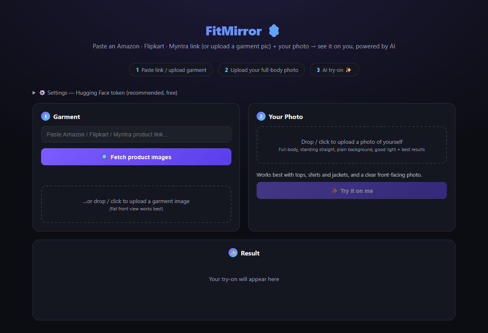

# 🪞 FitMirror — AI Virtual Try-On

**Upload a garment photo → upload your photo → see the outfit on yourself.**

FitMirror is a 100% free, serverless virtual try-on web app. It pulls garment images straight from product pages (Amazon, Flipkart, Myntra…) and runs an open-source AI model (**IDM-VTON**) on Hugging Face's free GPU tier — no backend, no API bills, no infrastructure.

🔗 **Live demo:** https://isosmart.online



---

## ✨ Features

- **Product-link fetching (best effort)** - paste a product page or a direct image link. Stores that block bots (Amazon and Myntra returned bot walls in our 2026-11-17 test) fall back to upload.
- 📤 **Manual fallback** — upload or drag-and-drop a garment image when auto-fetch is blocked (some storefronts block scraping).
- 🧑 **Your photo, your fit preview** — full-body photo in, AI-generated try-on out.
- 🔐 **Bring-your-own token** — users paste their own free Hugging Face token (stored only in their browser's localStorage) to unlock dedicated ZeroGPU quota. Nothing is sent to any third-party server besides Hugging Face itself.
- 🪶 **Single-file app** — one `index.html`, zero build step, deployable anywhere static files are served.

## 🚀 Quick Start

### Use it hosted (nothing to install)
1. Open **https://isosmart.online**
2. *(Recommended)* ⚙️ Settings → paste a free HF token from [huggingface.co/settings/tokens](https://huggingface.co/settings/tokens) (`Read` access is enough)
3. Paste a product link *or* upload a garment image
4. Upload a full-body photo of yourself
5. Hit **✨ Try it on me** and wait ~1–3 min for the free GPU

### Self-host

```bash
git clone https://github.com/prithvirz/fitmirror.git
cd fitmirror
# open index.html directly, or serve it:
python3 -m http.server 8080
# → http://localhost:8080
```

No build tools, no dependencies, no `.env`. Deploy the folder as-is to GitHub Pages / Netlify / Vercel / Cloudflare Pages / here.now.

## 🏗️ How It Works

```
┌────────────┐   1. paste link    ┌──────────────┐   product images
│  Browser   │ ─────────────────► │  r.jina.ai   │ ─────────────┐
│ (index.html)│                   │  Reader API  │              ▼
│            │                    └──────────────┘    ┌─────────────────────┐
│            │   2. person + garment + blank mask     │ yisol/IDM-VTON  │
│            │ ─────────────────────────────────────► │ HF Space (ZeroGPU)  │
│            │                                        │  · AutoMasker       │
│            │   3. try-on result image               │  · IDM-VTON pipeline │
│            │ ◄───────────────────────────────────── └─────────────────────┘
└────────────┘
```

1. **Link extraction** — the page text/images are fetched through Jina Reader (CORS-friendly), plausible product photos are regex-filtered (icons and thumbnails dropped), then re-encoded locally.
2. **Local re-encoding** — every image is drawn onto a `<canvas>` and exported as PNG before upload (this sidesteps a Gradio RGBA/JPEG bug — see [Troubleshooting](docs/TROUBLESHOOTING.md)).
3. **Try-on inference** — the [@gradio/client](https://www.npmjs.com/package/@gradio/client) JS SDK calls the public IDM-VTON Space with `(person_editor, garment, cloth_type, steps=30, cfg=2.5, seed)`; a blank mask layer triggers the server's automatic human-parsing masker.

Full details in [`docs/ARCHITECTURE.md`](docs/ARCHITECTURE.md).

## 📖 Documentation

| Doc | Contents |
|-----|----------|
| [Architecture](docs/ARCHITECTURE.md) | Data flow, API contract, component reference |
| [Deployment](docs/DEPLOYMENT.md) | Hosting on Cloudflare Workers (live), GitHub Pages, Netlify; custom domains |
| [Troubleshooting](docs/TROUBLESHOOTING.md) | Every error we hit and its fix (RGBA-JPEG, IndexError, quota…) |

## Status

Live at https://isosmart.online. MVP stage, solo maintainer, no paid infrastructure. Check the engine any time with 
ode tests/smoke.mjs`.

## ⚠️ Limitations & Honest Notes

- Results are **AI visualisations**, not exact size/fit previews.
- Complex patterns, dresses and unusual poses can produce artifacts — retry with a different photo.
- Each run takes about 20-60 seconds on Hugging Face's free ZeroGPU tier; anonymous users share a small daily quota (hence the token field).
- Link auto-fetch is best effort. In our 2026-11-17 test Amazon and Myntra pages were blocked by the reader service, so uploading a garment photo is the reliable path.

## 🛣️ Roadmap

- [x] Result gallery with localStorage history
- [ ] More storefronts (Ajio, Meesho, Myntra deep-links)
- [x] Try-on engine moved from CatVTON to IDM-VTON when the CatVTON Space went down (2026-11)
- [x] Before/after slider
- [ ] Optional paid-API mode (FASHN / Replicate IDM-VTON) behind the same UI

## Contributing

See [CONTRIBUTING.md](CONTRIBUTING.md). Issues and pull requests are welcome.

## 🙏 Credits

- [IDM-VTON](https://huggingface.co/spaces/yisol/IDM-VTON) - Choi *et al.*, "Improving Diffusion Models for Authentic Virtual Try-on in the Wild" (ECCV 2024). Open-source model + demo Space.
- [Hugging Face ZeroGPU](https://huggingface.co/docs/hub/spaces-zerogpu) — free community GPU hosting
- [Jina Reader](https://jina.ai/reader) — link → markdown/image extraction
- [@gradio/client](https://www.npmjs.com/package/@gradio/client) — browser SDK for Gradio Spaces

## 📄 License

[MIT](LICENSE) © 2026 prithvirz

## Contact

Built by [IsoSmart](https://isosmart.online), a solo-founder project (MVP stage). Questions: head@isosmart.online
